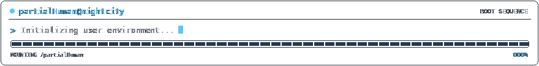
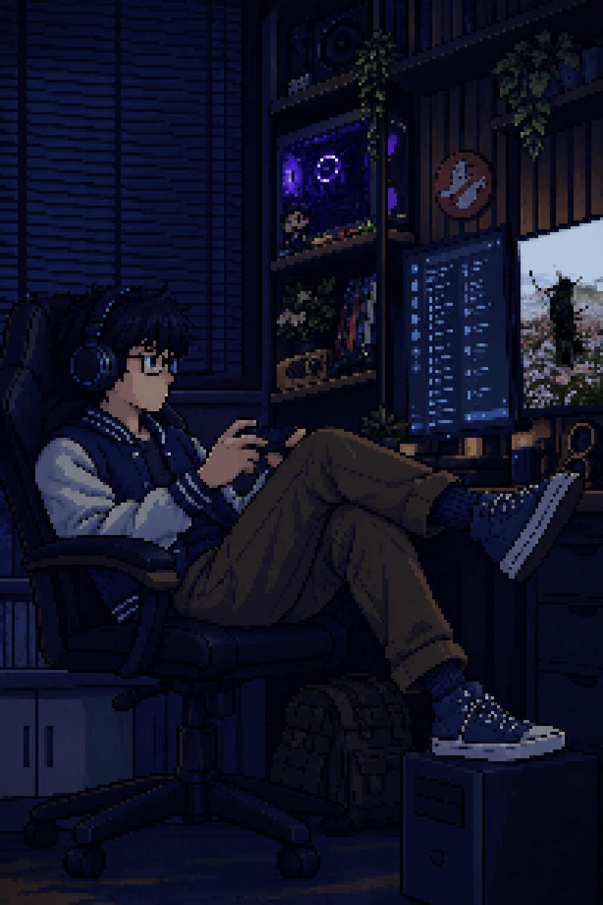
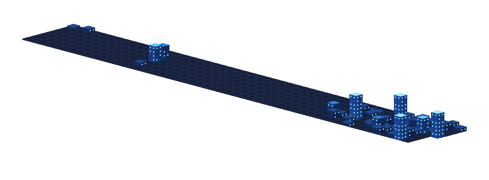
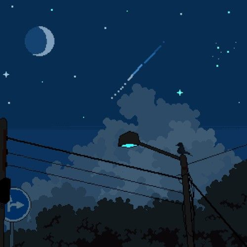
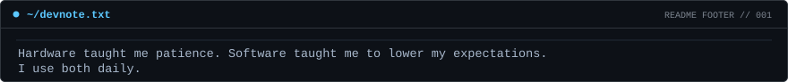

  

<h1 align="center">
  Hey, I'm partialHuman
  
</h1>

  

  

 

<table>
<tr>
<td width="280" align="center">
  
</td>
<td>
     

Hi, I'm an electronics student who likes designing digital circuits and getting them running on real FPGA boards. I write Verilog for fun, build small things with **TypeScript** and **Node.js** when I want a change, and spend a suspicious amount of time making my Windows & Linux setup look better than it needs to. 

Hardware by training, software by curiosity.

🛠️ Hardware design, simulation and on-board testing 
🐧 Linux, GNOME Shell tweaks and VS Code extensions 
🎮 Steam games, mostly to recover from debugging 
☕ Powered by coffee, music and a suspicious number of retries 
📈 One commit closer to competent

If you want to talk hardware, open source or why my testbench passed but the board didn't, say hi.

>**Known issues:** sleep, merge conflicts, and "it works on my board."

</td>
</tr>
</table>

 

<table align="center" width="100%">
<tbody>
<tr>
<td align="center" valign="middle" colspan="2">

<b>🖥️ Languages &amp; Core</b>

</td>
</tr>
</tbody>
<tbody>
<tr>
<td align="center" valign="middle" colspan="2">

  
  
  
  
  
  
  
  
  
  
  
  
  
  
  

</td>
</tr>
</tbody>
<tbody>
<tr>
<td align="center" valign="middle" width="50%">

<b>🔧 VLSI &amp; Hardware</b>

</td>
<td align="center" valign="middle" width="50%">

<b>🐧 Operating Systems</b>

</td>
</tr>
</tbody>
<tbody>
<tr>
<td align="center" valign="middle" width="50%">

  
  
  
  
  
  

</td>
<td align="center" valign="middle" width="50%">

  
  
  
  
  
  

</td>
</tr>
</tbody>
<tbody>
<tr>
<td align="center" valign="middle" width="50%">

<b>🤖 Embedded &amp; Vision</b>

</td>
<td align="center" valign="middle" width="50%">

<b>☁️ Cloud &amp; DevOps</b>

</td>
</tr>
</tbody>
<tbody>
<tr>
<td align="center" valign="middle" width="50%">

  
  
  
  
  

</td>
<td align="center" valign="middle" width="50%">

  
  
  
  

</td>
</tr>
</tbody>
<tbody>
<tr>
<td align="center" valign="middle" width="50%">

<b>📊 Data &amp; ML</b>

</td>
<td align="center" valign="middle" width="50%">

<b>🧰 Dev Tools</b>

</td>
</tr>
</tbody>
<tbody>
<tr>
<td align="center" valign="middle" width="50%">

  
  

</td>
<td align="center" valign="middle" width="50%">

  
  
  
  
  
  

</td>
</tr>
</tbody>
<tbody>
<tr>
<td align="center" valign="middle" colspan="2">

<b>🛡️ Networking &amp; Security</b>

</td>

</tr>
</tbody>
<tbody>
<tr>
<td align="center" valign="middle" colspan="2">

  
  
  
  
  
  

</td>
</tr>
</tbody>
</table>

 

  <a href="https://github.com/partialHuman/Guardrails-Gateway">
    <picture>
      <source media="(prefers-color-scheme: dark)" srcset="https://github-readme-stats.vercel.app/api/pin/?username=partialHuman&repo=Guardrails-Gateway&border_radius=8&description_lines_count=2&bg_color=0d1117&border_color=30363d&title_color=ffd27a&icon_color=5cc8ff&text_color=c9d1d9&ring_color=5cc8ff">
      <source media="(prefers-color-scheme: light)" srcset="https://github-readme-stats.vercel.app/api/pin/?username=partialHuman&repo=Guardrails-Gateway&border_radius=8&description_lines_count=2&bg_color=ffffff&border_color=d0d7de&title_color=9a6700&icon_color=0969da&text_color=24292f">
      
    </picture>
  </a>
  <a href="https://github.com/partialHuman/Secure-Vending-Machine-Controller">
    <picture>
      <source media="(prefers-color-scheme: dark)" srcset="https://github-readme-stats.vercel.app/api/pin/?username=partialHuman&repo=Secure-Vending-Machine-Controller&border_radius=8&description_lines_count=2&bg_color=0d1117&border_color=30363d&title_color=ffd27a&icon_color=5cc8ff&text_color=c9d1d9&ring_color=5cc8ff">
      <source media="(prefers-color-scheme: light)" srcset="https://github-readme-stats.vercel.app/api/pin/?username=partialHuman&repo=Secure-Vending-Machine-Controller&border_radius=8&description_lines_count=2&bg_color=ffffff&border_color=d0d7de&title_color=9a6700&icon_color=0969da&text_color=24292f">
      
    </picture>
  </a>

  <a href="https://github.com/partialHuman/Adaptive-Communication-System-Using-Dynamic-Function-eXchange">
    <picture>
      <source media="(prefers-color-scheme: dark)" srcset="https://github-readme-stats.vercel.app/api/pin/?username=partialHuman&repo=Adaptive-Communication-System-Using-Dynamic-Function-eXchange&border_radius=8&description_lines_count=2&bg_color=0d1117&border_color=30363d&title_color=ffd27a&icon_color=5cc8ff&text_color=c9d1d9&ring_color=5cc8ff">
      <source media="(prefers-color-scheme: light)" srcset="https://github-readme-stats.vercel.app/api/pin/?username=partialHuman&repo=Adaptive-Communication-System-Using-Dynamic-Function-eXchange&border_radius=8&description_lines_count=2&bg_color=ffffff&border_color=d0d7de&title_color=9a6700&icon_color=0969da&text_color=24292f">
      
    </picture>
  </a>
  <a href="https://github.com/partialHuman/pfsense-Telegram-Monitoring-Suite">
    <picture>
      <source media="(prefers-color-scheme: dark)" srcset="https://github-readme-stats.vercel.app/api/pin/?username=partialHuman&repo=pfsense-Telegram-Monitoring-Suite&border_radius=8&description_lines_count=2&bg_color=0d1117&border_color=30363d&title_color=ffd27a&icon_color=5cc8ff&text_color=c9d1d9&ring_color=5cc8ff">
      <source media="(prefers-color-scheme: light)" srcset="https://github-readme-stats.vercel.app/api/pin/?username=partialHuman&repo=pfsense-Telegram-Monitoring-Suite&border_radius=8&description_lines_count=2&bg_color=ffffff&border_color=d0d7de&title_color=9a6700&icon_color=0969da&text_color=24292f">
      
    </picture>
  </a>

  <a href="https://github.com/partialHuman?tab=repositories">See all repositories →</a>

 

<table width="100%">
<thead>
<tr><th align="left" width="40%">Quest</th><th align="left" width="40%">Stack</th><th align="center" width="20%">Status</th></tr>
</thead>
<tbody>
<tr>
<td width="40%"><b>FlexRISC16</b> 5-stage pipelined 16-bit CPU</td>
<td width="40%"> </td>
<td width="20%" align="center"></td>
</tr>
</tbody>
<tbody>
<tr>
<td width="40%"><b>Edge-AI Surveillance</b> FPGA partial reconfiguration</td>
<td width="40%"> </td>
<td width="20%" align="center"></td>
</tr>
</tbody>
<tbody>
<tr>
<td width="40%"><b>ProjectTree</b> project tree and Mermaid generator</td>
<td width="40%"> </td>
<td width="20%" align="center"></td>
</tr>
</tbody>
<tbody>
<tr>
<td width="40%"><b>Music Flyout</b> GNOME Shell music controller</td>
<td width="40%"> </td>
<td width="20%" align="center"></td>
</tr>
</tbody>
</table>

 

  <picture>
    <source media="(prefers-color-scheme: dark)" srcset="https://github-readme-stats.vercel.app/api?username=partialHuman&show_icons=true&bg_color=0d1117&border_color=30363d&title_color=ffd27a&icon_color=5cc8ff&text_color=c9d1d9&ring_color=5cc8ff">
    <source media="(prefers-color-scheme: light)" srcset="https://github-readme-stats.vercel.app/api?username=partialHuman&show_icons=true&bg_color=ffffff&border_color=d0d7de&title_color=9a6700&icon_color=0969da&text_color=24292f&ring_color=0969da">
    
  </picture>
  <picture>
    <source media="(prefers-color-scheme: dark)" srcset="https://github-readme-streak-stats.herokuapp.com/?user=partialHuman&background=0d1117&border=30363d&stroke=30363d&ring=5cc8ff&fire=ffd27a&currStreakNum=e6edf3&sideNums=5cc8ff&currStreakLabel=ffd27a&sideLabels=c9d1d9&dates=8b949e">
    <source media="(prefers-color-scheme: light)" srcset="https://github-readme-streak-stats.herokuapp.com/?user=partialHuman&background=ffffff&border=d0d7de&stroke=d0d7de&ring=0969da&fire=9a6700&currStreakNum=24292f&sideNums=0969da&currStreakLabel=9a6700&sideLabels=57606a&dates=57606a">
    
  </picture>

  <picture>
    <source media="(prefers-color-scheme: dark)" srcset="https://github-readme-stats.vercel.app/api/top-langs/?username=partialHuman&layout=compact&langs_count=12&card_width=460&bg_color=0d1117&border_color=30363d&title_color=ffd27a&icon_color=5cc8ff&text_color=c9d1d9&ring_color=5cc8ff">
    <source media="(prefers-color-scheme: light)" srcset="https://github-readme-stats.vercel.app/api/top-langs/?username=partialHuman&layout=compact&langs_count=12&card_width=460&bg_color=ffffff&border_color=d0d7de&title_color=9a6700&icon_color=0969da&text_color=24292f&ring_color=0969da">
    
  </picture>
  

 

  <picture>
    <source media="(prefers-color-scheme: dark)" srcset="profile-3d-contrib/profile-city.svg">
    <source media="(prefers-color-scheme: light)" srcset="profile-3d-contrib/profile-city-light.svg">
    
  </picture>

 

<table align="center">
<tr>
<td align="center" width="33%"> <b>Late nights</b></td>
<td align="center" width="33%"> <b>Fuel</b></td>
<td align="center" width="33%"> <b>Music</b></td>
</tr>
</table>

 

<table align="center" width="100%">
<tbody>
<tr>
<td align="center" valign="middle" colspan="2">

<b>📬 On the clock, find me here</b>

</td>
<td align="center" valign="middle" colspan="2">

<b>🎮 Off the clock, find me here</b>

</td>
</tr>
</tbody>
<tbody>
<tr>
<td align="center" valign="middle" colspan="2">

  
  
  

</td>
<td align="center" valign="middle" colspan="2">

  
  

</td>
</tr>
</tbody>
</table>

  

  

  

